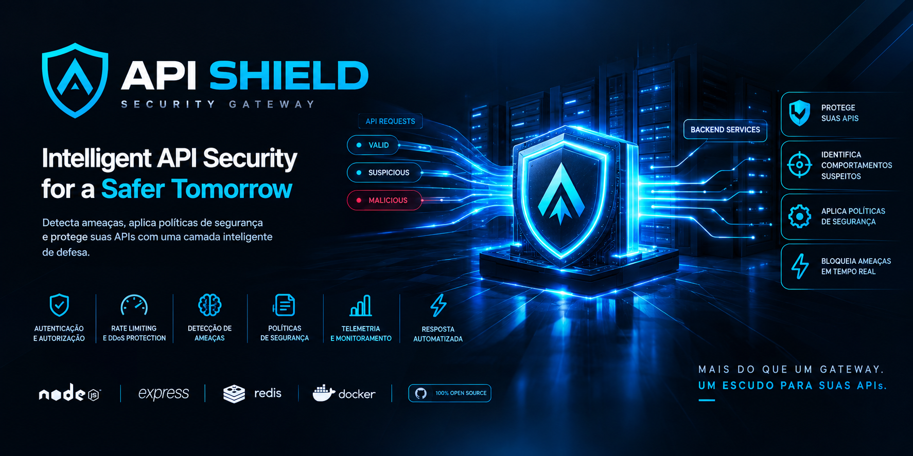

# 🛡️ API Shield

## Intelligent API Security Gateway for Threat Detection, Policy Enforcement and Automated Protection



**API Shield** é um gateway de segurança para APIs desenvolvido com foco em **Web Security, proteção de APIs, detecção de ameaças e resposta automatizada**.

O projeto atua como uma camada intermediária entre clientes e serviços backend, analisando requisições, aplicando políticas de segurança, identificando comportamentos suspeitos e gerenciando respostas defensivas contra possíveis ataques.

O objetivo é simular uma arquitetura moderna utilizada em ambientes corporativos para proteção de APIs, combinando conceitos de:

- API Gateway Security
- Threat Detection
- Rate Limiting
- Authentication & Authorization
- Security Policies
- Behavioral Analysis
- Incident Management
- Security Telemetry

---

# 🚀 Principais Recursos

## 🔐 Authentication & Authorization

Sistema de autenticação baseado em:

- JWT
- Controle de escopos (`scopes`)
- Proteção de endpoints sensíveis
- Tokens administrativos separados

Exemplo:

```http
Authorization: Bearer <token>
```

---

# 🛡️ Security Gateway

O API Shield funciona como uma camada defensiva antes dos serviços internos.

Fluxo:

```
Client
  |
  v
API Shield Gateway
  |
  +--> Authentication
  |
  +--> Policy Engine
  |
  +--> Rate Limiting
  |
  +--> Threat Detection
  |
  +--> Security Telemetry
  |
  v
Backend Services
```

---

# 🚦 Rate Limiting

Controle de abuso baseado em Redis.

Protege contra:

- Excessive requests
- Brute force
- API abuse
- Automated attacks

Exemplo:

```
60 requests / 60 seconds
```

Configuração ajustável via ambiente.

---

# 🧠 Threat Detection Engine

O API Shield possui mecanismos de análise comportamental.

Detecta padrões como:

## Authentication Attack

Excesso de falhas de autenticação:

```
Multiple failed login attempts
```

---

## Route Discovery Attack

Identificação de exploração sistemática de endpoints:

```
/users
/admin
/internal
/debug
/config
```

---

## Multi-Signal Correlation

Combina diferentes eventos:

```
Failed Login
+
Forbidden Request
+
Rate Limit Violation

=
High Risk Activity
```

---

# 📊 Security Telemetry

Todos os eventos relevantes são registrados para análise:

- Requests suspeitas
- Alertas
- Violações de políticas
- Tentativas de ataque
- Decisões de segurança

Armazenamento:

```
Redis
 |
 +--> Security Events
 |
 +--> Alerts
 |
 +--> Incident Data
```

---

# ⚙️ Policy Engine

Sistema de regras de segurança configuráveis.

Exemplo:

```json
[
  {
    "id": "block-admin-route",
    "enabled": true,
    "action": "deny",
    "match": {
      "routePrefix": "/admin"
    }
  }
]
```

Recursos:

- Allow/Deny rules
- Route-based policies
- Scope validation
- Temporary blocking
- Administrative controls

---

# 🚨 Automated Response

Quando uma ameaça é identificada, o sistema pode:

- Bloquear IP temporariamente
- Negar requisições
- Criar alertas
- Registrar incidentes

Exemplo:

```
Suspicious IP detected

↓

Temporary Block

↓

Security Event Created

↓

Administrator Review
```

---

# 🖥️ Security Dashboard

Painel administrativo para acompanhamento:

- Eventos recentes
- Alertas
- Estatísticas de segurança
- Políticas ativas
- Bloqueios temporários

Interface focada em monitoramento operacional.

---

# 🏗️ Arquitetura

```
                 Internet

                    |
                    v

          +----------------+
          | API Shield     |
          | Security Layer |
          +----------------+

              /    |    \

             /     |     \

      Auth       Policies    Detection

       |            |            |

       v            v            v

    JWT        Rules Engine   Threat Engine


                    |

                    v

              Backend APIs
```

---

# 🧰 Tecnologias Utilizadas

## Backend

- Node.js
- Express.js
- JavaScript ES Modules

## Security

- JWT Authentication
- Helmet
- Rate Limiting
- Security Headers
- Policy Enforcement

## Database / Storage

- Redis

## Infrastructure

- Docker
- Docker Compose

## Testing

- Node Test Runner
- Automated Security Tests

---

# 📂 Estrutura do Projeto

```
api-shield/

├── src/

│   ├── auth/
│   ├── gateway/
│   ├── middleware/
│   ├── policy/
│   ├── security/
│   ├── rate-limit/
│   └── config/

├── public/

│   └── dashboard/

├── tests/

├── Dockerfile

├── compose.yaml

└── README.md
```

---

# 🧪 Testes

O projeto possui uma suíte automatizada cobrindo:

✅ Authentication  
✅ Authorization  
✅ Policy Validation  
✅ Threat Detection  
✅ Risk Scoring  
✅ Rate Limiting  
✅ Request Validation  
✅ Docker Configuration  
✅ Deployment Rules  

Resultado atual:

```
23 Tests Passed
0 Failures
```

---

# 🐳 Executando com Docker

Clone o projeto:

```bash
git clone https://github.com/eu-waliston/API-SHIELD.git

cd API-SHIELD
```

Crie o ambiente:

```bash
cp .env.example .env
```

Gere seus segredos:

```bash
openssl rand -hex 32
```

Configure:

```env
JWT_SECRET=
ADMIN_API_TOKEN=
REDIS_PASSWORD=
```

Execute:

```bash
docker compose up --build -d
```

Verifique:

```bash
docker compose ps
```

Teste:

```bash
curl http://127.0.0.1:3000/health
```

---

# 🔒 Security Considerations

Este projeto foi desenvolvido seguindo boas práticas:

- Não executar containers como root
- Não armazenar segredos no código
- Validar entradas administrativas
- Evitar exposição de informações internas
- Utilizar headers de segurança
- Aplicar princípio de menor privilégio

Para ambientes reais recomenda-se:

- TLS obrigatório
- Reverse proxy seguro
- Monitoramento externo
- Rotação de credenciais
- Pentest periódico

---

# 🗺️ Roadmap

## ✅ Phase 1
Foundation

- Gateway base
- Estrutura inicial
- Configuração

## ✅ Phase 2
Gateway Security

- JWT
- Scopes
- Rate Limiting

## ✅ Phase 3
Threat Intelligence

- Eventos
- Correlação
- Risk Score

## ✅ Phase 4
Security Console

- Dashboard
- Telemetria
- Incidentes

## ✅ Phase 5
Policy Engine

- Regras
- Bloqueios
- Respostas automáticas

## ✅ Phase 6
Advanced Detection

- Behavioral Detection
- Multi-signal Analysis

## ✅ Phase 7
Hardening

- Security Validation
- Defensive Improvements

## ✅ Phase 8
Production Deployment

- Docker
- Deployment Architecture
- Operational Readiness

---

# 🎯 Objetivos do Projeto

O API Shield foi criado como projeto de estudo e portfólio para explorar:

- Segurança de aplicações web
- Arquitetura de APIs
- Engenharia defensiva
- Desenvolvimento backend seguro
- Cloud & Infrastructure Security

---

# 👨‍💻 Autor

**Waliston**

Fullstack Developer • Software Engineer • Cybersecurity • Problem Solver

GitHub:

https://github.com/eu-waliston

---

# ⭐ Contribuição

Sugestões, melhorias e discussões sobre segurança são bem-vindas.

Projetos de segurança evoluem através de revisão constante, testes e colaboração.
